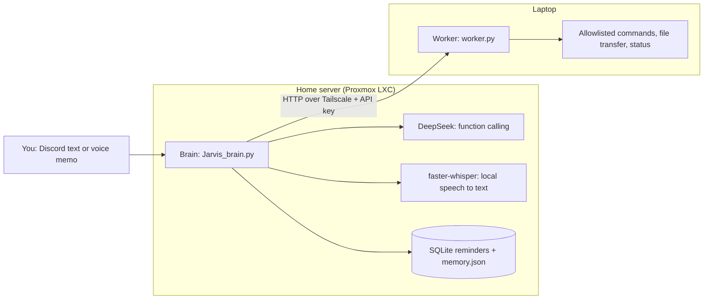

# Jarvis

[](https://github.com/G13B13/Jarvis/actions/workflows/ci.yml)

[](LICENSE)

A self-hosted personal assistant you control from Discord, by text or voice memo.
A **brain** on a home server understands what you say (DeepSeek function calling + local Whisper) and tells a **worker** on your laptop what to do, over a private Tailscale network. The worker can only run a fixed allowlist of actions.

<!-- Add a screenshot or GIF at docs/demo.png, then uncomment the next line:

-->

## How it works



1. You send `j open spotify`, or a voice message, in Discord. Only your Discord user ID is obeyed.
2. Exact short commands (`status`, `volume 40`, `shutdown laptop`) are handled directly. Anything else goes to DeepSeek, which can only call a small set of tools.
3. The brain sends a named command to the worker, with a secret key, over Tailscale.
4. The worker checks the key, looks the command up in its allowlist and runs it.

## Features

- **Natural language and voice:** talk to it normally, or send a Discord voice message, which is transcribed locally with faster-whisper.
- **Laptop control:** launch apps and sites, search, volume, brightness, Wi-Fi, Bluetooth, screenshots, sleep/shutdown/reboot.
- **Files:** pull a file from the laptop into Discord, or push an attachment to `~/Downloads` (8 MB limit).
- **Reminders:** `j remind me to call mom in 30 minutes`, stored in SQLite and delivered in Discord.
- **Automation:** 07:00 daily briefing (weather and laptop status), low-battery alerts, daily conversation summary.
- **Memory that survives restarts:** recent conversation and the daily summary are saved to `memory.json`.

## Commands

| You type | What happens |
|---|---|
| `j status` | CPU, RAM, disk, battery and uptime of the laptop |
| `j open firefox` / `j open calculator` | Launches the app |
| `j search youtube for lo-fi` | Opens the search in Firefox |
| `j volume 40`, `j volume up`, `j mute` | Audio control (0-100) |
| `j send me ~/Documents/report.pdf` | Uploads the file to Discord |
| *(attach a file)* `j save this` | Saves the attachment to `~/Downloads` |
| `j remind me to call mom in 30 minutes` | Creates a reminder (`in ...`, `at 3pm`, `tomorrow 9am`) |
| `j shutdown laptop` | Asks for confirmation. Reply `YES` within 30 seconds |
| `j I want to watch some videos` | The LLM decides what to do |

## Security model

The worker can run commands on a real laptop, so most of the engineering went into limiting what it will accept. Each row below is covered by an automated test.

| Risk | Mitigation |
|---|---|
| Anyone on the network calls the worker | Every route needs `X-API-Key`, compared in constant time. The secret lives in `.env`, never in source |
| Worker exposed on the LAN | Binds to the Tailscale IP only (`WORKER_BIND`), never `0.0.0.0` |
| Arbitrary command execution | `/execute` only runs names from a fixed allowlist, as argument lists. No shell, no arbitrary program names |
| Injection through arguments | Search text is URL-encoded, volume and brightness are parsed as integers and clamped |
| Reading secrets off the laptop | `/get_file` only reads inside `WORKER_ALLOWED_DIRS`, resolves symlinks and `..`, and refuses dotfiles (`.ssh`, `.env`) |
| Overwriting or escaping on upload | `/save_file` strips paths, never overwrites and caps the size |
| The LLM doing something destructive | The LLM's tool list has no power commands. Sleep, shutdown and reboot are only reachable through exact commands plus a one-shot `YES` that expires in 30 seconds |
| Leaked credentials | `.env` is gitignored, `.env.example` has placeholders only, and history is scanned before publishing |

## Quick start

You need two machines on one [Tailscale](https://tailscale.com) network, a Discord bot token ([create one](https://discord.com/developers/applications), enable **Message Content Intent**) and a DeepSeek API key.

### 1. Worker (the laptop)

```bash
sudo apt install xclip pulseaudio-utils brightnessctl network-manager rfkill scrot
git clone https://github.com/G13B13/Jarvis.git ~/jarvis-worker && cd ~/jarvis-worker
python3 -m venv venv && source venv/bin/activate
pip install -r requirements-worker.txt
cp .env.example .env && chmod 600 .env     # set WORKER_SECRET and WORKER_BIND (tailscale ip -4)
python worker.py                           # test run; Ctrl+C to stop
```

To run it as a service, edit `YOUR_USERNAME` in `services/jarvis-worker.service`, then:

```bash
sudo cp services/jarvis-worker.service /etc/systemd/system/
sudo systemctl daemon-reload && sudo systemctl enable --now jarvis-worker
```

### 2. Brain (the home server)

```bash
sudo apt install ffmpeg
sudo useradd --system --home /opt/jarvis --shell /usr/sbin/nologin jarvis
sudo git clone https://github.com/G13B13/Jarvis.git /opt/jarvis && cd /opt/jarvis
sudo python3 -m venv venv && sudo venv/bin/pip install -r requirements-brain.txt
sudo cp .env.example .env        # set DISCORD_TOKEN, DEEPSEEK_API_KEY, WORKER_SECRET, YOUR_DISCORD_USER_ID, WORKER_URL
sudo chown -R jarvis:jarvis /opt/jarvis && sudo chmod 600 /opt/jarvis/.env
sudo cp services/jarvis-brain.service /etc/systemd/system/
sudo systemctl daemon-reload && sudo systemctl enable --now jarvis-brain
journalctl -u jarvis-brain -f
```

`WORKER_SECRET` must be identical on both machines. Generate one with `openssl rand -hex 32`.

If the brain runs in an unprivileged LXC container and the service fails with `status=226/NAMESPACE`, remove the `ProtectSystem`, `ProtectHome` and `PrivateTmp` lines from the unit, or enable nesting for the container.

## Configuration

| Variable | Used by | Purpose |
|---|---|---|
| `WORKER_SECRET` | both | Shared API key. Must match |
| `DISCORD_TOKEN`, `DEEPSEEK_API_KEY` | brain | Credentials |
| `YOUR_DISCORD_USER_ID` | brain | The only user the bot obeys |
| `WORKER_URL`, `ROBOT_URL` | brain | Worker `/execute` URL and optional robot server |
| `MEMORY_PATH` | brain | Where chat memory is saved (default `memory.json` next to the code) |
| `WORKER_BIND`, `WORKER_PORT` | worker | Tailscale IP and port to listen on |
| `WORKER_ALLOWED_DIRS` | worker | Folders `send me` may read (default `~/Documents,~/Downloads`) |

## Development

```bash
python3 -m venv venv && source venv/bin/activate
pip install -r requirements-dev.txt
python -m pytest -q tests
```

CI runs the same tests plus a lint for syntax errors and undefined names on every push. The tests cover the worker's security properties (auth, allowlist, path traversal, symlink escape, input handling), reminder time parsing, the confirmation flow and memory persistence.

```
Jarvis_brain.py       Discord bot and DeepSeek function calling
confirmation.py       YES-to-confirm decision logic (unit-tested)
memory_store.py       Atomic JSON persistence for chat memory (unit-tested)
reminders.py          SQLite reminders and time parsing
worker.py             Laptop API
services/             systemd units for brain and worker
tests/                pytest suite
```

## Status and roadmap

| Working | Not in this repo yet |
|---|---|
| Text and voice commands, function calling | Robot arm server (PCA9685 + Arduino): works locally, not published |
| File transfer, screenshots, system control | Camera object detection |
| Reminders, briefing, battery alerts, persistent memory | Google Meet creation (planned) |

Known limitation: the Discord voice-channel wake word was dropped because the voice-receive extension was unstable. Voice memos are the reliable path. Planned: an ESP32 push-to-talk node and multi-worker support.

## Tech stack

discord.py, DeepSeek (OpenAI-compatible SDK), faster-whisper, Flask + waitress, SQLite, APScheduler, Tailscale, systemd, GitHub Actions.

## License

MIT. See [LICENSE](LICENSE).
